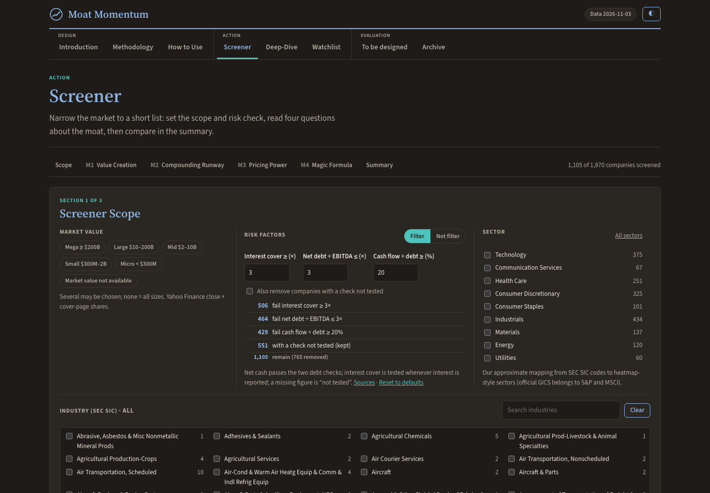

# Moat Momentum · Moat Screener (US, SEC EDGAR)

> การบ้าน AI Investor Alpha · **Find the companies whose moat is real and getting stronger, from public filings.**

| | |
|---|---|
| **ชื่อเล่น** | Jitti |
| **กลุ่ม** | G03 |
| **โจทย์ 1 บรรทัด** | Screen ~1,900 US companies for a real and strengthening competitive moat using only SEC filings, and explain why each one deserves a deeper look |
| **ลิงก์ผลงาน** | Dashboard: download the [`output/`](output/) folder and open `output/moat_momentum.html` in a browser (no server needed) · [spec (original brief)](spec.md) · [current design](docs/specs/2026-11-04-dashboard-pivot-design.md) · [work log](prompts.md) · [lessons](PROJECT_MEMORY.md) |
| **สถานะ** | พร้อมตรวจ (2026-11-04): Moat Screener, Deep-Dive, Watchlist with 5-slide pitch decks; 151 automated tests pass |

---

## What the tool does now

The project started as an attempt to **predict** future compounders and ended as a **screening tool** that points an analyst at strong candidates and shows the evidence. The dashboard has three groups of tabs:

- **Design:** Introduction (the business case), Methodology (every measure, source and blind spot), How to Use (workflow and a worked example).
- **Action:**
  - **Screener:** set the scope (market value, sector, industry) and a risk check (interest cover, net debt ÷ EBITDA, cash flow ÷ debt), then read four 2×2 "Moat Screeners", each from well-known research:
    1. Value Creation: growth vs clean ROIC (McKinsey, *Valuation*)
    2. Compounding Runway: reinvestment rate vs return on new capital (Mauboussin & Callahan, "Measuring the Moat")
    3. Pricing Power: gross-margin change vs growth (Novy-Marx 2013)
    4. Magic Formula: return on capital vs earnings yield (Greenblatt 2005)

    A summary ranks companies by how many of the four they pass.
  - **Deep-Dive:** each company's business description from its 10-K, key numbers, all four results with their 4-quarter trend, and rule-based "why look deeper / what to watch".
  - **Watchlist:** priority A/B/C, long notes, and a **5-slide pitch deck** per company.
- **Evaluation:** Archive (the journey below) and a placeholder for future tracking.

All figures are 12-month (TTM) numbers from each company's latest 10-Q or 10-K (SEC EDGAR, one-off items removed); prices are Yahoo Finance closes. Every number on the page shows its source and date.

## What we learned (honest results)

| Version | Idea | Result |
|---|---|---|
| v1.0 | Moat Score: 13 indicators ranked within industry | Picks stayed strong but did not keep improving; market test Jul 2013–Oct 2026 14.3% a year = S&P 500 (14.3%) with more risk |
| v1.2 | Score on 12-month data | Looked better only through look-ahead; not adopted |
| v2.0 | Compounder Signal | Failed its one-time test: 1.18× vs 2× required |
| v3.0 | Moat Map movement rules | All three failed: 0.69×, 0.59×, 0.65× |
| Today | Moat Screener | A candidate list, not a forecast; not back-tested on purpose |

Details: the Archive tab, [`prompts.md`](prompts.md) (every round and decision) and [`PROJECT_MEMORY.md`](PROJECT_MEMORY.md) (problems and rules).

## Work on another Mac (iMac / MacBook)

The code, outputs, logs and AI instructions are all in this repo. Two things are deliberately **not** in git: your `.env` (SEC contact) and the 4 GB SEC data cache.

1. **Get the repo:** `git clone https://github.com/Jittia/aia-hw-jitti.git` (put it in the same place as on the other Mac, inside your course workspace).
2. **Every time you switch Mac:** run `git pull` before you start, and finish with `/save` (it commits and pushes). Never work on both Macs without pulling first.
3. **Python (only to re-run the data, not to view the dashboard):** `python3 -m venv .venv && .venv/bin/pip install -r requirements.txt` (Python 3.10). Node (`brew install node`) runs the page's JavaScript tests; without it those tests skip.
4. **`.env`:** `cp .env.example .env` and put your name and email in `SEC_USER_AGENT` (SEC requires it).
5. **Data cache (`data/cache/`, 4.1 GB):** copy it once from the other Mac (AirDrop or a USB drive) into the same folder. Rebuilding from scratch is possible but slow: download `companyfacts.zip` and `submissions.zip` from SEC into `data/cache/bulk/`, then run in this order: `src/mm_extract.py`, `src/mm_extract.py cover`, `src/mm_extract.py leading`, `src/mm_run.py`, `src/mm_adr.py`, `src/mm_run.py` again (applies the ADS ratios), `src/mm_brief.py` (about 20 minutes).
6. **Tests:** `.venv/bin/python -m unittest discover tests`.
7. **The published dashboard and its shared Watchlist** live in your claude.ai account, so they are the same on both Macs. To republish from a new Claude session, give it the dashboard's claude.ai link.

## ไฟล์ใน repo นี้

| ไฟล์ | ใส่อะไร |
|---|---|
| `spec.md` | โจทย์ของคุณ 5 หัวข้อ (หัวใจของการบ้าน) |
| `prompts.md` | บันทึกขั้นตอนทุกรอบ: ทำอะไร, prompt, ผลที่ได้, ตัดสินใจเพราะอะไร |
| `PROJECT_MEMORY.md` | ปัญหาที่เจอ, วิธีแก้, และกฎที่ได้จากบทเรียน |
| `output/` | Dashboard (`moat_momentum.html` + `data/`), screenshot, and earlier reports kept for reference (Proof, spot-check, specs) |
| `help.md` | ติดตรงไหน 3 ข้อ ให้ผู้สอนเตรียมคำตอบ |
| `archive/` | งานรุ่นก่อน (catalyst-of-change radar) เก็บไว้ดูย้อนหลัง |
| `AGENTS.md` | คำสั่งให้ AI ทุกค่ายทำงานใน repo นี้ (`CLAUDE.md` และ `GEMINI.md` ชี้มาที่ไฟล์นี้) |
| `.claude/commands/save.md` | ขั้นตอนของคำสั่ง `/save` |

## ก่อนเริ่มทำการบ้านทุกครั้ง

- [ ] เปิดโฟลเดอร์ `homework/aia-hw-…` ของคุณเป็นที่ทำงานใน Claude
- [ ] ถามว่า "ตอนนี้ทำถึงไหน" Claude ต้องตอบจาก `prompts.md` ได้ (ถ้าตอบไม่ได้ = เปิดผิดโฟลเดอร์)
- [ ] เช็ก model · effort · permission
- [ ] ดูคอมเมนต์ผู้สอนในแท็บ Issues ของ repo บน GitHub

ระหว่างทำ: เปิด Plan mode ก่อนงานใหม่ · ทำทีละรอบ · ทุกตัวเลขต้องมี source · ติดตรงไหนจดลง `help.md`

## บันทึกงานทุกรอบ: พิมพ์ `/save`

ทำงานเสร็จแต่ละรอบ ให้พิมพ์ `/save` ใน Claude (ใส่สรุปสั้น ๆ ต่อท้ายได้ เช่น `/save ร่าง spec รอบแรก`) AI จะทำให้ครบ:

1. ตรวจว่าไม่มี key หรือข้อมูลส่วนตัว
2. เพิ่มบันทึกขั้นตอนใน `prompts.md`
3. บันทึกปัญหาและบทเรียนใน `PROJECT_MEMORY.md` ถ้ามี
4. commit ด้วยข้อความ `รอบ N: ทำอะไร` แล้ว push ขึ้น GitHub

ใช้ Codex หรือ Gemini: พิมพ์ว่า `save` ได้เหมือนกัน (ขั้นตอนเดียวกัน อยู่ใน `.claude/commands/save.md`)

ถ้า commit เองหรืออัปโหลดผ่านหน้าเว็บ GitHub ให้เขียน entry ใน `prompts.md` เองตามแบบฟอร์มในไฟล์

## ไทม์ไลน์

| วัน | ทำอะไร |
|---|---|
| เสาร์ 31 ต.ค. · 17:45 | repo + spec ร่างแรก |
| **พุธ 4 พ.ย. · 21:00** | **Deadline: ส่งฉบับพร้อมตรวจ** |
| พฤ–ศ 5–6 พ.ย. | ผู้สอนคอมเมนต์ใน Issues ของ repo นี้ |
| เสาร์ 7 พ.ย. · 13:30 | Repair Clinic ในห้อง |

ส่งลิงก์ repo ครั้งเดียวในวันเรียน ผ่าน **Google Form ที่ผู้สอนแจกในห้อง (สแกน QR บนจอ)** งานที่ `/save` เพิ่มภายหลังจะอัปเดตใน repo เอง ไม่ต้องส่งซ้ำ

## ห้ามขึ้น Public

repo นี้ใครก็เปิดดูได้ ห้ามใส่สิ่งเหล่านี้เด็ดขาด

- API key · password · token · ไฟล์ `.env`
- พอร์ตจริง · จำนวนหุ้น · เลขบัญชี · ข้อมูลส่วนตัว
- ข้อมูล SETSMART ที่ซื้อมา (ไฟล์ดิบ)
- บทวิเคราะห์โบรกเกอร์ (ติดลิขสิทธิ์)

ถ้าเผลอ push key ขึ้นไปแล้ว: **เปลี่ยน key ใหม่ทันที** การลบไฟล์ทิ้งอย่างเดียวไม่พอ เพราะประวัติใน git ยังเก็บไว้

## เช็กก่อนส่ง

- [x] repo เป็น Public และเปิดได้จากหน้าต่าง incognito (checked 2026-11-02: page loads without login)
- [x] `spec.md` ครบ 5 หัวข้อ
- [x] `prompts.md` มีบันทึกอย่างน้อย 3 รอบ และทุก commit มี entry คู่กัน (23 rounds)
- [x] `PROJECT_MEMORY.md` มีปัญหาหรือบทเรียนอย่างน้อย 1 ข้อ
- [x] `output/` มีภาพหรือลิงก์อย่างน้อย 1 ชิ้น
- [x] `help.md` reviewed: no help requests at this time (Jitti, 2026-11-04)
- [x] ไม่มี key, password หรือข้อมูลพอร์ตจริงในทุกไฟล์
- [ ] ส่งลิงก์แล้ว
