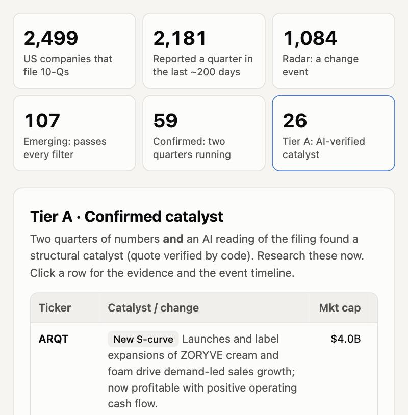

# Catalyst-of-Change Radar (US)

> การบ้าน AI Investor Alpha · Phase 1.5 (US) · reworked from Phase 1

| | |
|---|---|
| **ชื่อเล่น** | Jitti |
| **กลุ่ม** | G03 · catalyst-of-change watchlist |
| **โจทย์ 1 บรรทัด** | Spot companies where a catalyst of change (new TAM, new S-curve, turnaround, new market) has just become visible in their own filings, early enough that ≥5x in 5 years is still ahead (10x as a stretch) |
| **ลิงก์ผลงาน** | [`output/`](output/): [dashboard](output/dashboard.html) (download and open), [watchlist CSV](output/watchlist.csv), [event study](output/event_study_report.md) |
| **สถานะ** | พร้อมตรวจ (Phase 1.5: US) |

---

## Results (Phase 1.5, as of 2026-11-02)

- **How it works:** every quarter, each company's SEC filings are checked for a **change**: revenue accelerating, gross margin stepping up, turning profitable, or contracted revenue jumping. Each change is dated by its filing.
  - **Emerging:** a change that beats the industry median, is organic, has limited dilution and still leaves room for 5x.
  - **Confirmed:** Emerging two quarters in a row.
  - **AI check:** AI reads the company's filings to confirm the catalyst; code verifies every quote.
- **Today:** 2,499 companies → 1,084 on Radar → 107 Emerging → 59 Confirmed → **26 Tier A**: 11 new S-curve, 7 new TAM, 5 new market, 3 turnaround; 12 with a 10x-stretch flag.
  - **Tier B:** 38 Emerging names.
  - **Vetoed:** 33 Confirmed names the AI found to be a cycle, acquisition or one-off.
- **Does it work?** Event study 2012→2021 with a true holdout (2018–2021), not used for any choice:
  - **Confirmed** companies reached ≥5x **1.68x** more often than all companies (8.7% vs 5.1%).
  - **Emerging:** 1.43x.
  - **Radar alone:** no edge (0.99x). The filters create the edge, not the raw change.
  - **Best single signals:** gross-margin step-up and turning profitable.
  - **No signal:** 8-K officer changes and material agreements.
- **Phase 1 → 1.5:**
  - Phase 1 ranked one date for 10x and found 1 confirmed name. Its results are kept in `output/shortlist.csv` and `output/backtest_report.md`.
  - What changed: a 5x target (enough events to test), dated change events, an industry-cycle filter, an acquisition flag, and an event study.
- **Limits:**
  - Survivors only (delisted companies missing).
  - Emerging is just under the 1.5x goal.
  - The AI veto is not backtested.
  - Earnings-call transcripts come next (Phase 1.6). See [`help.md`](help.md).
- **Method in detail:** [`spec.md`](spec.md) (v2 brief), [`prompts.md`](prompts.md) (all rounds: what, why, results), [`PROJECT_MEMORY.md`](PROJECT_MEMORY.md) (problems and rules), [`src/`](src/) (code), [`tests/`](tests/).

## ไฟล์ใน repo นี้

| ไฟล์ | ใส่อะไร |
|---|---|
| `spec.md` | โจทย์ของคุณ 5 หัวข้อ (หัวใจของการบ้าน) |
| `prompts.md` | บันทึกขั้นตอนทุกรอบ: ทำอะไร, prompt, ผลที่ได้, ตัดสินใจเพราะอะไร |
| `PROJECT_MEMORY.md` | ปัญหาที่เจอ, วิธีแก้, และกฎที่ได้จากบทเรียน |
| `output/` | ภาพหน้าจอ หรือลิงก์ผลงาน |
| `help.md` | ติดตรงไหน 3 ข้อ ให้ผู้สอนเตรียมคำตอบ |
| `AGENTS.md` | คำสั่งให้ AI ทุกค่ายทำงานใน repo นี้ (`CLAUDE.md` และ `GEMINI.md` ชี้มาที่ไฟล์นี้) |
| `.claude/commands/save.md` | ขั้นตอนของคำสั่ง `/save` |

## ก่อนเริ่มทำการบ้านทุกครั้ง

- [ ] เปิดโฟลเดอร์ `homework/aia-hw-…` ของคุณเป็นที่ทำงานใน Claude
- [ ] ถามว่า "ตอนนี้ทำถึงไหน" Claude ต้องตอบจาก `prompts.md` ได้ (ถ้าตอบไม่ได้ = เปิดผิดโฟลเดอร์)
- [ ] เช็ก model · effort · permission
- [ ] ดูคอมเมนต์ผู้สอนในแท็บ Issues ของ repo บน GitHub

ระหว่างทำ: เปิด Plan mode ก่อนงานใหม่ · ทำทีละรอบ · ทุกตัวเลขต้องมี source · ติดตรงไหนจดลง `help.md`

## บันทึกงานทุกรอบ: พิมพ์ `/save`

ทำงานเสร็จแต่ละรอบ ให้พิมพ์ `/save` ใน Claude (ใส่สรุปสั้น ๆ ต่อท้ายได้ เช่น `/save ร่าง spec รอบแรก`) AI จะทำให้ครบ:

1. ตรวจว่าไม่มี key หรือข้อมูลส่วนตัว
2. เพิ่มบันทึกขั้นตอนใน `prompts.md`
3. บันทึกปัญหาและบทเรียนใน `PROJECT_MEMORY.md` ถ้ามี
4. commit ด้วยข้อความ `รอบ N: ทำอะไร` แล้ว push ขึ้น GitHub

ใช้ Codex หรือ Gemini: พิมพ์ว่า `save` ได้เหมือนกัน (ขั้นตอนเดียวกัน อยู่ใน `.claude/commands/save.md`)

ถ้า commit เองหรืออัปโหลดผ่านหน้าเว็บ GitHub ให้เขียน entry ใน `prompts.md` เองตามแบบฟอร์มในไฟล์

## ไทม์ไลน์

| วัน | ทำอะไร |
|---|---|
| เสาร์ 31 ต.ค. · 17:45 | repo + spec ร่างแรก |
| **พุธ 4 พ.ย. · 21:00** | **Deadline: ส่งฉบับพร้อมตรวจ** |
| พฤ–ศ 5–6 พ.ย. | ผู้สอนคอมเมนต์ใน Issues ของ repo นี้ |
| เสาร์ 7 พ.ย. · 13:30 | Repair Clinic ในห้อง |

ส่งลิงก์ repo ครั้งเดียวในวันเรียน ผ่าน **Google Form ที่ผู้สอนแจกในห้อง (สแกน QR บนจอ)** งานที่ `/save` เพิ่มภายหลังจะอัปเดตใน repo เอง ไม่ต้องส่งซ้ำ

## ห้ามขึ้น Public

repo นี้ใครก็เปิดดูได้ ห้ามใส่สิ่งเหล่านี้เด็ดขาด

- API key · password · token · ไฟล์ `.env`
- พอร์ตจริง · จำนวนหุ้น · เลขบัญชี · ข้อมูลส่วนตัว
- ข้อมูล SETSMART ที่ซื้อมา (ไฟล์ดิบ)
- บทวิเคราะห์โบรกเกอร์ (ติดลิขสิทธิ์)

ถ้าเผลอ push key ขึ้นไปแล้ว: **เปลี่ยน key ใหม่ทันที** การลบไฟล์ทิ้งอย่างเดียวไม่พอ เพราะประวัติใน git ยังเก็บไว้

## เช็กก่อนส่ง

- [x] repo เป็น Public และเปิดได้จากหน้าต่าง incognito (checked 2026-11-02: page loads without login)
- [x] `spec.md` ครบ 5 หัวข้อ
- [x] `prompts.md` มีบันทึกอย่างน้อย 3 รอบ และทุก commit มี entry คู่กัน (8 rounds)
- [x] `PROJECT_MEMORY.md` มีปัญหาหรือบทเรียนอย่างน้อย 1 ข้อ
- [x] `output/` มีภาพหรือลิงก์อย่างน้อย 1 ชิ้น
- [ ] `help.md` เขียนครบ 3 ข้อ (AI draft written; Jitti to review and edit)
- [x] ไม่มี key, password หรือข้อมูลพอร์ตจริงในทุกไฟล์
- [ ] ส่งลิงก์แล้ว
